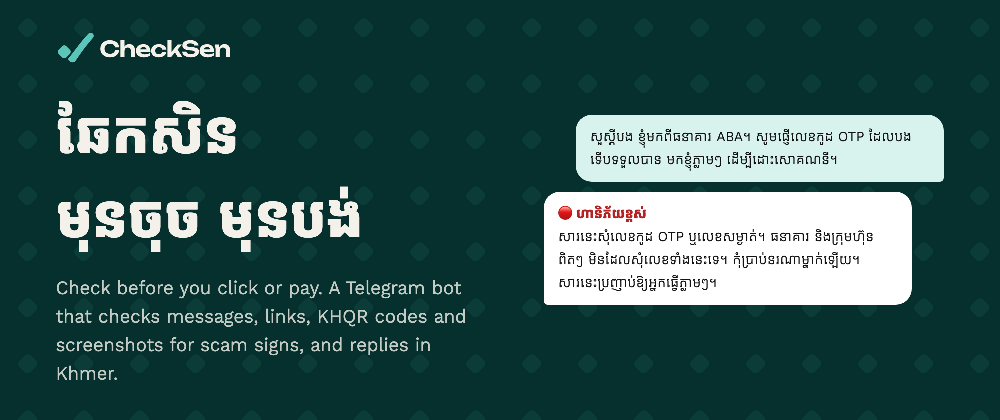
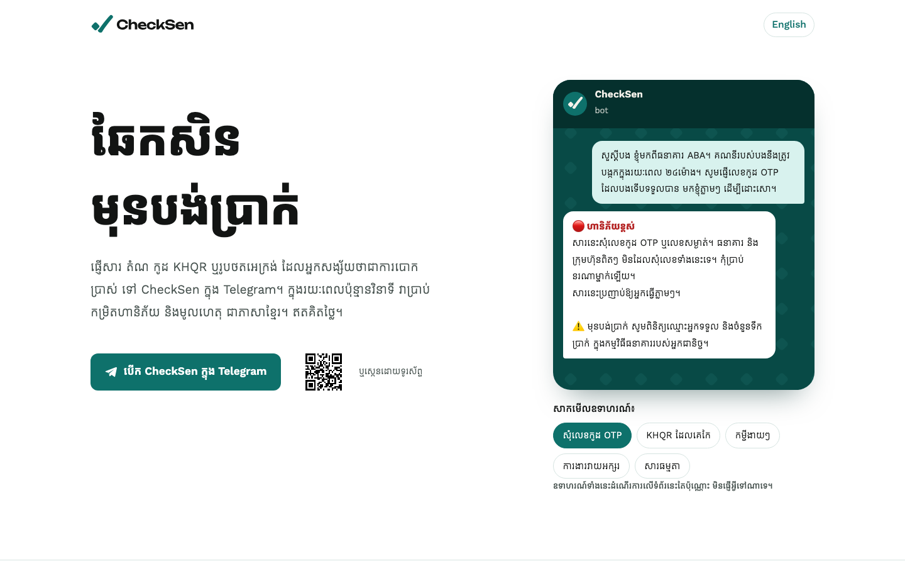

<a href="https://checksen.horizxon.tech"></a>

<p align="center">
  <a href="https://t.me/CheckSen_bot"></a>
  <a href="https://checksen.horizxon.tech"></a>
  <a href="https://github.com/tangheng05/checksen/actions/workflows/ci.yml"></a>
  <a href="LICENSE"></a>
</p>

# CheckSen (ឆែកសិន)

"Check first": a free Telegram bot for people in Cambodia. Before you click, open or pay, forward it the message, link, KHQR code, screenshot or file, and within seconds it replies with a risk level and the reasons behind it. Replies are in Khmer, or in English if you write to it in English.

**Try it:** [t.me/CheckSen_bot](https://t.me/CheckSen_bot). Nothing to install. The website at [checksen.horizxon.tech](https://checksen.horizxon.tech) shows example replies in Khmer and English.

> **Status:** live and free to use, but still early. The rules are tuned against real Cambodian scam messages, and they keep improving.

## What it checks

| You send | It checks |
| --- | --- |
| A KHQR code (photo or screenshot) | Who the QR really pays: merchant name, account, bank and amount, and whether the code is valid KHQR or was edited |
| A link | Whether Google Safe Browsing knows it as phishing or malware, who owns the site, where it redirects, how new the domain is, free hosting that anyone can use, lookalikes of bank, wallet, Telegram and government domains, and, for unknown sites, the page title, a bank's name in it, and password fields |
| A text message | Common scam patterns in Khmer and English: OTP requests, upfront fees for loans, jobs or prizes, account-freeze threats, fake police, scam-compound job ads, extortion, online gambling ads, Telegram accounts posing as bank support, and more |
| A screenshot of a message | Reads the text in it and checks it the same way as a text message, along with any caption and links |
| A file | Its real type from its first bytes (a "PDF" that is really an `.exe`), double extensions like `.pdf.exe`, the hidden reverse-text trick, programs and passwords inside `.zip` files, bank-named apps and fake-login web pages. It also looks inside: what an Android app is allowed to do (read SMS codes, control the screen, draw fake login screens), Office macros, PDFs that run scripts or programs, saved web pages that send passwords away, and links inside PDFs and web pages. When set up, it adds a ClamAV scan and a VirusTotal lookup. A photo or KHQR screenshot sent as a file gets the same check as a photo |
| Who forwarded it | Flags personal accounts named like a bank or Telegram ("ABA Bank Support", "Telegram Security"), since neither writes to people from personal accounts, and names official channels |
| A message forwarded from Telegram's own account | Confirms it really came from Telegram and warns never to share the login code; it isn't sent to the AI |
| A question, or "I already paid" | A fixed, reviewed answer: what to do right away if you were scammed, how to report, whether banks ever ask for codes, and what the bot can check |

Each reply gives one of four levels:

| Level | Meaning |
| --- | --- |
| 🔴 ហានិភ័យខ្ពស់ (High risk) | Clear scam signs. Don't pay, and don't share any code. |
| 🟠 គួរឱ្យសង្ស័យ (Suspicious) | Some warning signs. Check through an official number or app first. |
| ⚪ មិនទាន់រកឃើញសញ្ញាបោកប្រាស់ទេ (No scam signs found yet) | No known tricks found. The bot never says a message is "safe". |
| ❔ មិនអាចពិនិត្យបាន (Can't tell) | The image was unclear or couldn't be read. |

Every reply ends by reminding you to check the recipient's name in your own bank app before paying.

Voice messages and videos can't be checked yet; the bot asks for a screenshot or the text instead. In a group, it only replies when someone mentions @CheckSen_bot, replies to it, or sends `/check` in reply to a message.

<a href="https://checksen.horizxon.tech"></a>

## How well it works

Every change is scored against labelled real-world messages in CI. Recall is the share of scams caught; the false positive rate is the share of genuine messages wrongly flagged.

| Benchmark | Rules only | Rules + Gemini |
| --- | --- | --- |
| v1: 87 real messages, mostly English | 80.4% recall, 0% false positives | 95.7% recall, 7.3% false positives |
| v2: 162 real Khmer messages | 52.9% recall, 3.1% false positives | 94.1% recall, 3.9% false positives |

The data, labels and how they were collected are in [`evals/`](evals/README.md). A pull request that lowers recall or raises false positives on the rules-only benchmark fails CI.

## How it works

- **Fixed rules come first:** QR parsing and checksum validation (via [khqr-rs](https://github.com/tangheng05/khqr-rs)), domain age and lookalike checks, and Khmer and English scam-wording rules.
- **A language model handles what the rules can't decide.** By default this is Google Gemini's free tier. It returns only a category and what the person seems to want (to check a message, ask a question, or get help after being scammed), so every reply is fixed, reviewed Khmer or English text. It can't raise a verdict to High risk without a rule signal it can point to, and low-confidence answers are dropped.
- **Screenshots:** QR codes in a photo are decoded first. Otherwise Gemini reads the text in the screenshot, and that text goes through the same rules.
- **Files:** the bot reads a file's first bytes to learn what it really is, whatever its name says, and lists what's inside `.zip` files without unpacking them. It reads an app's permission list, a document's macro project, a PDF's actions and a saved web page's form, all in memory. Links found inside a file are checked by name, domain age and Google Safe Browsing, but never opened, so one-time links in private documents aren't used up. When configured, ClamAV scans the file on the same server and VirusTotal is asked about its SHA-256 fingerprint. Antivirus only knows viruses someone has already found, so a clean result still comes with "only open files from people you trust".

## Privacy

- Links, and every page they redirect through, are sent to Google Safe Browsing when it is configured.
- Files are downloaded into memory (up to Telegram's 20 MB bot limit, or 100 MB with a [local Bot API server](#files-up-to-100-mb)), checked, and discarded. ClamAV runs on the same server, so files never leave it. VirusTotal gets only the file's SHA-256 fingerprint; files are never uploaded. Bigger files are judged by their name and type only.
- Messages and images are checked in memory and never saved. Replies are cached for an hour under a hash of the content, and rate limits use a hash of your Telegram ID, both in memory only.
- When AI checking is on, message text and screenshots are sent to Google's Gemini API (free tier) to read and classify them. Google may use free-tier inputs to improve its products and have people review them, so `/help` asks you to hide account numbers and personal details first.
- The language you write in is remembered in memory for 30 days, under a hash of your Telegram ID, so forwarded messages get replies in your language.
- For a link to a site it doesn't know, the bot opens the page once from its server to read the title. It never opens links to well-known services, so one-time login links aren't used up.
- If you tap "No" on a KHQR check, the bot stores a report against that payment account, linked only to a keyed hash of your Telegram ID. An account is shown as reported only after 3 different people report it.
- `/forget` deletes every report linked to you.

## Run it yourself

You need a recent stable Rust (1.96 or newer) and a bot token from [@BotFather](https://t.me/BotFather).

```sh
cp .env.example .env                 # then fill in the values below
docker compose up -d postgres        # optional, only for KHQR reports
cargo run --release --bin checksen
```

| Variable | Needed | What it does |
| --- | --- | --- |
| `TELOXIDE_TOKEN` | yes | The Telegram bot token |
| `GEMINI_API_KEY` | recommended | AI text checks and screenshot reading, using the free tier from [Google AI Studio](https://aistudio.google.com/apikey) |
| `GEMINI_MODEL` | no | A model, or a comma-separated list tried in order when one is busy or out of quota (default `gemini-3.5-flash-lite,gemini-3.1-flash-lite`). Use a single model for `eval --llm` runs |
| `ANTHROPIC_API_KEY` | no | Uses Claude for text checks instead of Gemini |
| `DATABASE_URL` | no | Postgres for KHQR reports; migrations run on start |
| `HASH_SECRET` | with `DATABASE_URL` | At least 32 random characters, used to hash reporter IDs |
| `SAFE_BROWSING_API_KEY` | no | Free [Google Safe Browsing](https://developers.google.com/safe-browsing/v4/get-started) key for checking links against known phishing and malware sites |
| `CLAMD_ADDRESS` | no | ClamAV daemon, as a socket path (`/var/run/clamav/clamd.ctl`) or `host:port`, for scanning files |
| `VIRUSTOTAL_API_KEY` | no | Free key from [virustotal.com](https://www.virustotal.com/gui/my-apikey); looks up file fingerprints (500 a day) |
| `TELEGRAM_API_URL` | no | A [local Bot API server](#files-up-to-100-mb) such as `http://127.0.0.1:8081`, which raises the file limit from 20 MB to 100 MB |

To keep it running on a Linux server, a systemd service is enough:

```ini
# /etc/systemd/system/checksen.service
[Unit]
Description=CheckSen bot
After=network-online.target

[Service]
WorkingDirectory=/opt/checksen
ExecStart=/opt/checksen/target/release/checksen
Restart=always

[Install]
WantedBy=multi-user.target
```

To scan files with ClamAV on Ubuntu, install it and point the bot at its socket (it needs about 1.5 GB of RAM):

```sh
sudo apt install clamav-daemon
sudo systemctl enable --now clamav-freshclam clamav-daemon
echo 'CLAMD_ADDRESS=/var/run/clamav/clamd.ctl' >> /opt/checksen/.env
```

#### Files up to 100 MB

Telegram only lets bots download 20 MB through its servers. To check files up to 100 MB, run Telegram's own Bot API server next to the bot in `--local` mode. It saves each file before the bot reads and deletes it, so keep its folder in memory with tmpfs. Get an `api_id` and `api_hash` from [my.telegram.org](https://my.telegram.org), then:

```sh
sudo mkdir -p /var/lib/telegram-bot-api
echo 'tmpfs /var/lib/telegram-bot-api tmpfs size=1g 0 0' | sudo tee -a /etc/fstab
sudo mount /var/lib/telegram-bot-api
docker run -d --restart=always --name telegram-bot-api -p 127.0.0.1:8081:8081 \
  -e TELEGRAM_API_ID=... -e TELEGRAM_API_HASH=... -e TELEGRAM_LOCAL=1 \
  -v /var/lib/telegram-bot-api:/var/lib/telegram-bot-api aiogram/telegram-bot-api
curl "https://api.telegram.org/bot$TELOXIDE_TOKEN/logOut"   # once, before the first start
echo 'TELEGRAM_API_URL=http://127.0.0.1:8081' >> /opt/checksen/.env
```

The bot must run on the same machine, since it reads files from that folder. ClamAV skips anything over 25 MB by default, so raise its limits too (big files need a few hundred MB of free RAM while they're checked):

```sh
sudo sed -i 's/^StreamMaxLength .*/StreamMaxLength 100M/; s/^MaxFileSize .*/MaxFileSize 100M/; s/^MaxScanSize .*/MaxScanSize 400M/' /etc/clamav/clamd.conf
sudo systemctl restart clamav-daemon
```

The bot exits if the Bot API server isn't up yet, for example right after a reboot. So have systemd wait for Docker and keep retrying:

```sh
sudo mkdir -p /etc/systemd/system/checksen.service.d
printf '[Unit]\nAfter=docker.service\nStartLimitIntervalSec=0\n[Service]\nRestartSec=5\n' | sudo tee /etc/systemd/system/checksen.service.d/wait.conf
sudo systemctl daemon-reload
```

Then `systemctl enable --now checksen`. To update: `git pull && cargo build --release && systemctl restart checksen`.

### Development

```sh
cargo test                           # DB tests skip unless TEST_DATABASE_URL is set
cargo run --bin eval                 # rules-only benchmark, fails if worse than evals/baseline.json
cargo run --bin eval -- --llm gemini # the same benchmark with the AI classifier
```

CI runs `cargo fmt --check`, `cargo clippy --all-targets -- -D warnings`, `cargo test` and the benchmark.

## Website

`web/` is a static site with no build step: Khmer at `/` and English at `/en`. Preview it with `python3 -m http.server -d web`. On Vercel, import the repo, set the Root Directory to `web` and the Framework Preset to Other.

## Stack

Rust, [teloxide](https://docs.rs/teloxide/), reqwest, rxing and khqr-rs, moka, PostgreSQL with sqlx, Gemini (free tier) with Claude as an option, and [ClamAV](https://www.clamav.net/) and [VirusTotal](https://www.virustotal.com/) for files. Webhooks and Google Web Risk are planned.

## License

MIT. See [LICENSE](LICENSE).
